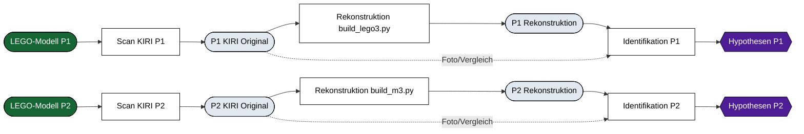

# FDOx-Metadaten: zwei LEGO-Pyramiden (KIRI-Scan → Rekonstruktion → Interpretation)

Stand: 2026-11-17 (v3, mit ZIP-Memo und Prüfung der vier Original-FDOx) · Autor der Modelle: Florian Thiery (Sketchfab `@fthiery`) · Rekonstruktionen und Interpretationen erzeugt mit Claude (Anthropic)

Dieses Dokument sammelt **alle Metadaten** für zwei FDOx: je eine Pyramide mit ihrem KIRI-Scan (Original) und ihrer Rekonstruktion aus idealisierten Steinen, dazu die Interpretationen (Was stellt das Objekt dar?) und eine Anleitung, wie Rekonstruktionen und Interpretationen **neu erzeugt** werden.

**Annahmen und Grenzen (bitte lesen):**
- Das FDOx-Schema selbst liegt mir nicht vor. Die Felder sind deshalb nach DCAT, PROV-O, Dublin Core und CRMdig geordnet und lassen sich in dein FDOx-Schema übertragen (Abschnitt 9 enthält ein Turtle-Gerüst).
- Alles, was ich nicht messen oder aus Dateien ablesen konnte, steht in Abschnitt 10 als **zu ergänzen**. Ich habe nichts erfunden. Scan-Sitzung, Geräte, Bauer, Bestätigung „Maya" und die vier Zenodo-DOIs stammen aus dem **ZIP-Memo** des FDOx-Chats (Abschnitt 11).
- Die Sketchfab-Angaben (Titel, Lizenz, Tags, Dreieckszahlen) habe ich am 2026-11-17 von den vier Seiten gelesen.

---

## 1. Überblick

Kürzel: **P1** = Pyramide mit Säule und Figur (Sketchfab: „Lego Pyramid"), **P2** = Pyramide mit grauen Treppen und Tempel (Sketchfab: „Lego Pyramid Maya").



Farben nach deinem Schema: grün = reales Objekt, grau = digitales Objekt, weiß = Aktivität, lila = Term/Hypothese.

---

## 2. Reale Objekte (zu beschreiben durch dich)

| | P1 | P2 |
|---|---|---|
| Arbeitsname | Pyramide mit Säule und Figur | Stufenpyramide mit grauen Treppen und Tempel |
| Technik | Klemmbausteine, Spielzeug | Klemmbausteine, Spielzeug |
| Gemessene Größe (aus Rekonstruktion) | 74,6 × 96 × 123 mm (B × T × H) | 96 × 96 × 71,5 mm |
| Besonderheit | Figur oben (Helm mit Spitze, Kettenhemd, Tunika, Umhang) | 4 graue Treppenarme, Tempel mit 4 Eckpfeilern |
| Bauer | Florian Thiery (Eigenbau, kein kommerzielles Set) | Daria Stefan, TU Wien (Eigenbau, kein kommerzielles Set; Zustimmung zur Veröffentlichung liegt vor) |
| Hersteller / Set | Eigenbau; Figurenstil erinnert an Cobi (nur Stil-Vermutung) | Eigenbau |

Die Maße sind die der idealisierten Rekonstruktion (Maßstab 2/3 echter LEGO-Maße, siehe Abschnitt 4), **nicht** am echten Objekt gemessen.

---

## 3. Digitale Objekte (vier Sketchfab-Modelle)

Die Zuordnung der Sketchfab-Seiten zu den lokalen Dateien ist über die **Dreiecks- und Knotenzahlen** eindeutig (Sketchfab-Zahl = Zahl in der Datei).

| ID | Sketchfab-Titel | URL | Rolle | Lokale Datei | Dreiecke / Knoten (Sketchfab → Datei) |
|---|---|---|---|---|---|
| D1 | Lego Pyramid (KIRI Original) | https://sketchfab.com/3d-models/lego-pyramid-kiri-original-b262c1135f1c4159bf1e3628d468bdc8 | Scan P1 | `in/AdvancedExport/3DModel_Custom.glb` | 135,6k / 68,2k → 135.616 / 68.248 (nach Merge) |
| D2 | Lego Pyramid Maya (KIRI Original) | https://sketchfab.com/3d-models/lego-pyramid-maya-kiri-original-1e9a188abf974999b7909e15323ded0a | Scan P2 | `m2/3DModel.obj` (+ `.mtl`, `.jpg`) | 53,5k / 27k → 53.482 / 26.996 (nach Merge) |
| D3 | Lego Pyramid (Reconstruction claude.ai) | https://sketchfab.com/3d-models/lego-pyramid-reconstruction-claudeai-e2fb31006245424e88033714af2c90f5 | Rekonstruktion P1 | `out4/lego.glb` | 50k / 26k → 49.964 / 25.962 |
| D4 | Lego Pyramid Maya (Reconstruction claude.ai) | https://sketchfab.com/3d-models/lego-pyramid-maya-reconstruction-claudeai-fe33b10adee4421fa3a06cc12f7d6c62 | Rekonstruktion P2 | `out6/lego3.glb` | 43k / 22,4k → 42.996 / 22.368 |

**Gemeinsame Sketchfab-Angaben:** Autor Florian Thiery (@fthiery) · Lizenz **CC BY 4.0** · Kategorie Architecture · Veröffentlicht 2026-11-17 · Download frei · Beschreibung: „No description provided." (bei allen vier, siehe Abschnitt 10).
**Tags auf Sketchfab:** D1 `lego` · D2 `pyramid, lego` · D3 `lego` (Seite zeigt „Generated with AI") · D4 `pyramid, reconstruction, lego, claude, maya`.

### Prüfsummen und technische Metadaten

| ID | Datei | Bytes | SHA-256 | Format |
|---|---|---|---|---|
| D1 | `3DModel_Custom.glb` | 12.021.164 | `796d9207d28a2b929e3482426a4b615c075c680d777d0c64644f2ae9bc3376b3` | glTF 2.0 Binary, Einheit Meter (glTF-Spezifikation), Y oben |
| D1 (Zweitexport) | `3DModel.obj` | 20.964.382 | `626e2bf5ba7d8035289e6368211ce96a9a8341e957ad5948b87d73419147d2df` | OBJ, 161.743 Flächen (anderer Export desselben Scans) |
| D2 | `3DModel.obj` | 5.986.977 | `79e79e2abdf19d6876bbb7b6b4ac9f114adb0ef304d4e74b0b2c9a47a8a011ab` | OBJ, Einheit unbekannt (größte Ausdehnung 0,652) |
| D2 | `3DModel.mtl` | – | `b958e8dc559ea9f83ed298ec647bd721d532e32b130fe7634ec6c3f402d9732c` | Material |
| D2 | `3DModel.jpg` | – | `94654aac04d4522ff3907d4daa861b8969c52f2feed8447e2f63739f7612121c` | Textur |
| D3 | `lego.glb` | 3.506.876 | `cf51067881aef419856a403725c1352c7c7d14715f286018066991afbc1e9569` | glTF 2.0 Binary, 22 Geometrien, Einheit Meter |
| D4 | `lego3.glb` | 3.613.760 | `543a744f2ec29f9b65c12008cd01b3b2fe829ccf1eeef1bc74b40a27943eac8b` | glTF 2.0 Binary, 2 Geometrien (weiß, grau), Einheit Meter |

Gemessene Geometrie (`inspect_model.py`):

| ID | Ausdehnung x × y × z | Komponenten | wasserdicht | Randkanten | Hinweis |
|---|---|---|---|---|---|
| D1 | 80,9 × 133,5 × 106,1 mm | 4 | nein | 911 | Scan, Up-Achse Y (glTF) |
| D2 | 0,628 × 0,423 × 0,652 (Einheit unbekannt) | 1 | nein | 508 | Scan um ca. 16° gedreht, entlang einer Achse um Faktor ≈ 0,72 gestaucht, Boden eingeschlossen |
| D3 | 74,6 × 123,0 × 95,9 mm | 380 | nein | 464 | Figur mit offenen Rändern |
| D4 | 95,9 × 71,5 × 95,9 mm | 435 | ja | 0 | – |

Die Facts-Dateien (`3DModel_Custom_facts.json`, `3DModel_facts.json`, `lego_facts.json`, `lego3_facts.json`) liegen im Paket unter `facts/`.

### Ableitungsbeziehungen (PROV)

- D3 `prov:wasDerivedFrom` D1 (nur Maße und Struktur gelesen; **kein** Mesh und keine Textur übernommen), plus 11 Fotos der Figur von dir.
- D4 `prov:wasDerivedFrom` D2 (Maße, Ausrichtung, Raster, Farbkarte gemessen), plus Foto/Angaben von dir (7 Stufen, Tempel-Detail).
- D1 und D2 sind **Primärdaten** (Scan), D3 und D4 **Interpretationsmodelle**.

---

## 4. Aktivitäten

### 4.1 Scan (beide)

| Feld | Wert |
|---|---|
| Software | KIRI Engine (Structure from Motion / Photogrammetrie) |
| Datum, Ort | 2026-11-12, Apothekertrakt Schloss Schönbrunn, Wien, während CHNT31 (Wikidata Q131330, 48,184424 N, 16,318911 E) |
| P1 | Samsung Galaxy S26, 69 Fotos, Scan 15:46 (aus dem Memo) |
| P2 | Samsung Galaxy A71, 115 Fotos (von Daria Stefan), Uhrzeit nicht erfasst |
| App-Version, Lichtverhältnisse | KIRI-App „latest", keine Versionsnummer in der App angezeigt; Licht **zu ergänzen** |
| Ausgaben | D1: GLB (AdvancedExport) und OBJ · D2: OBJ + MTL + JPG |

### 4.2 Rekonstruktion P1 (Skript `build_lego3.py`)

| Parameter | Wert |
|---|---|
| Methode | prozedurale Neuerzeugung aus idealisierten Steinen, nicht bereinigtes Scan-Mesh |
| Zufallsgenerator | `numpy.random.default_rng(11)` (Steinverteilung im Verborgenen ist zufällig, aber fest) |
| Maßstab | 2/3 der echten LEGO-Maße (Raster 8 mm × 2/3, Steinhöhe 9,6 mm × 2/3, Noppen Ø 4,8 mm × 2/3, Höhe 1,7 mm × 2/3), auf den Scan angepasst |
| Fuge / Fase | 0,05 mm Spalt, 0,14 mm Fase |
| Stufen | 9 Ebenen: 14×18, 12×16, 10×14, 8×12, 6×10, 4×8, 2×6, 2×4, 2×2 Noppen; Säule aus 5 Steinen (1×1) |
| Steine | 97× 2×4, 5× 2×2, 5× 1×1, alle weiß |
| Figur | komplett neu nach 11 Fotos in Minifigurmaßen (Helm mit Spitze und Wangenschutz, Gesicht mit Schnurrbart, Kettenhemd-Druck mit Schal und Gürtel, Tunika, Umhang, C-Hände, blaue Beine, braune Schuhe); Kopf und Torso mit gemalten Texturen (prozedural mit PIL) |
| Figurenhöhe | 32,3 mm |
| Ausgabe | `out4/lego.glb` (GLB) und OBJ/MTL |
| Bekannte Abweichungen | Farben von Umhang, Händen, Ärmeln etwas blasser als im Foto; Kettenhemd als Wabenmuster; Wangenschutz flach; Ärmel einfache Röhren |
| Zwischenstand verworfen | erst nur bereinigt (Boden abgeschnitten, Höhen geklemmt, Taubin-Glättung, Löcher geschlossen; Skript `beautify.py`); dir zu stark geglättet |

### 4.3 Rekonstruktion P2 (Skript `build_m3.py`, Version 4)

| Parameter | Wert |
|---|---|
| Zufallsgenerator | `numpy.random.default_rng(5)` |
| Ausrichtung des Scans | 16,25° (Schärfe-Histogramm um die Tempelmitte) |
| Raster und Steinhöhe | aus 4 Millionen Oberflächenpunkten abgeleitet (ca. 13 Zellen pro Noppe) |
| Stufen | 7 Ebenen; Treppenarme 4 Noppen breit, Reichweite 9, 8, 7, 6, 5, 4, 3 Noppen vom Zentrum |
| Weiße Eckflächen | 6×6, 5×5, 4×4, 3×3, auf Ebene 5 2×2; darüber frei |
| Tempel | 4 Lagen: graue 4×4, vier weiße 1×1-Eckpfeiler (dazwischen hohl), graue 4×4 als Sturz, graue 2×2 oben |
| Verdrehung | obere weiße Eckblöcke 2–7° (aus dem Scan); Pfeiler 14°, −12°, 16°, −9° (nach Augenmaß vom Nahfoto) |
| Steine | weiß: 32× 2×4, 20× 2×2, 12× 1×1, 8 Sonderbausteine 1×2/1×4; grau: 70× 2×4, 9× 2×2 |
| Farben | Weiß (245, 245, 241), Grau (48, 50, 48) |
| Ausgabe | `out6/lego3.glb` |

**Annahmen und Unsicherheiten P2:**
- Sieben Stufen nach Foto und deiner Angabe; der Scan legt eher 8 Ebenen mit 20×20 Noppen unten nahe (vermutlich verschmelzen die untersten mit dem Tisch). Das Messwerkzeug findet 8 gleichmäßig verteilte Ebenen (Abstand 0,09 der Höhe), vermutlich inklusive Basisplatte.
- Drehrichtung der Pfeiler und Verdrehung der Blöcke sind geschätzt.
- Treppenarme auf Ebene 6/7 im Foto nicht ganz symmetrisch, im Modell symmetrisch.
- Die Bodenfläche des Scans wurde nicht übernommen.

---

## 5. Neu-Erzeugung der Rekonstruktionen (Windows cmd)

Die beiden Skripte lesen **keine** Scandateien; alle aus dem Scan abgeleiteten Werte stehen als Konstanten im Skript. Sie schreiben relativ zum Arbeitsordner (`out4/lego.glb`, `out6/lego3.glb`).

```cmd
pip install numpy scipy trimesh pillow && python build_lego3.py && python build_m3.py
```

**Reproduzierbarkeit (geprüft):** Ich habe beide Skripte in einem leeren Ordner neu ausgeführt (Python 3.13.18, numpy 2.5.3, trimesh 5.2.1, Pillow 12.3.0, scipy 1.18.1). Die erzeugten GLB-Dateien sind **byte-identisch** zu D3 und D4 (MD5 `645431d9076b8fed68b80f9354c373f2` und `c0ee6b2b035d8540bbdcfe56f9635e03`, SHA-256 siehe Abschnitt 3). Mit anderen Bibliotheksversionen oder Betriebssystemen können die Bytes abweichen, Geometrie und Steinzahlen bleiben gleich; vergleiche dann Dreieckszahl und Ausdehnung (Tabelle Abschnitt 3).

Neu aus dem Scan messen (nur falls Parameter überprüft werden sollen): `analyze.py`, `probe.py`, `hm.py`, `pitch.py` im Paket unter `scripts/` (Höhenkarte, Raster, Ausrichtung). Sie erwarten die Scans unter `in/` bzw. `m2/` und wurden nicht als eigenes Paket bereinigt.

---

## 6. Interpretationen

### 6.1 Eigene Hypothesen (Claude im Projektgespräch, Vergleich Foto gegen Render, Graph `lrec_v0.3.ttl`)

Konfidenz = subjektive Schätzung, keine Messung; alle Hypothesen stehen auf **„offen: Bestätigung durch Flo nötig"**.

| Objekt | ID | Hypothese | Konfidenz |
|---|---|---|---|
| P1 | hyp_m1_a | Denkmal: Kriegerstatue auf einer Säule über gestuftem Sockel | 0,55 |
| P1 | hyp_m1_b | bestimmtes historisches Denkmal (Spezialfall von a, nicht bestimmbar) | 0,10 |
| P1 | hyp_m1_c | Stufenpyramide mit Figur als freie Spiel- oder Fantasieszene | 0,20 |
| P1 | hyp_m1_d | abstrahierter Wachturm mit Wachposten | 0,15 |
| Figur | hyp_f_a | mittelalterlicher Krieger / Soldat | 0,75 |
| Figur | hyp_f_b | Figur aus einer Cobi-Serie (nur Stilvermutung) | 0,40 |
| P2 | hyp_m2_a | mesoamerikanische (Maya-)Stufenpyramide mit Tempel, allgemein | 0,70 |
| P2 | hyp_m2_b | El Castillo in Chichén Itzá (Spezialfall von a) | 0,35 |
| P2 | hyp_m2_c | Angkor-Tempelberg mit Sanktuarium | 0,10 |
| P2 | hyp_m2_d | Zikkurat mit Tempel | 0,08 |
| P2 | hyp_m2_e | freies Design ohne bestimmtes Vorbild | 0,15 |

Wikidata-Verknüpfungen fehlen noch (Suchbegriffe sind im Graphen als `lrec:wikidataSearchTerm` gespeichert; IDs erzeugt `wikidata_match.py` auf deinem Rechner, Windows cmd: `pip install rdflib && python wikidata_match.py lrec_v0.3.ttl`).

**Bestätigung (laut Memo, 2026-11-17):** Die Erbauerin von P2 hat „Maya-Stufenpyramide" bestätigt (hyp_m2_a → *bestätigt*). „El Castillo" ist **nicht bestätigt** (hyp_m2_b → *vom Erbauer nicht bestätigt*; das ist keine Widerlegung, die Konfidenz 0,35 bleibt als ursprüngliche KI-Schätzung stehen). Beides ist in `lrec_v0.4.ttl` eingetragen, mit der Erbauer-Aussage als Evidenz `ev_m2_builder`. Für P1 bleiben alle Hypothesen offen.

### 6.2 Test mit frischen Instanzen ohne Vorwissen („Inkognito"-Toolkit, Schema 1.1)

Prompt, Messwerte und Bilder pro Lauf liegen im Paket unter `interpretations/`. Alle Antworten sind schema-konform und wurden in LREC-Turtle umgewandelt. Modell laut Selbstauskunft `claude-sonnet-5-5` (selbstberichtet, kann abweichen). Konfidenzen sind subjektiv und zwischen Läufen nicht vergleichbar.

| Lauf | Objekt | Stufen | Top-Hypothesen (Konfidenz) |
|---|---|---|---|
| t4 / answer1 | D4 (P2) | 8 | Pyramide mit Treppen und Gipfeltempel (0,80) → mesoamerikanisch (0,60) → **El Castillo, Chichén Itzá (0,30)**; Gipfelstruktur als Tempelkammer (0,50); freies Design (0,30) |
| t5 / answer1 | D3 (P1) | 6 | Denkmal mit Säule und Statue (0,55); Figur mit Helm (0,50); Stufenpyramide mit Figur an der Spitze (0,35) |
| t5 / answer2 (Durchgang 2) | D3 (P1) | 6 | wie oben, dazu Trajanssäule (0,15), Nelsonsäule (0,10), Helm als frühmittelalterlicher Spangenhelm (0,30), Pyramide nach Djoser (0,12) |

Frühere Läufe mit Schema 1.0 (t1 bis t3) liegen als Verlauf bei; sie waren allgemeiner (Stufenpyramide, mesoamerikanisch 0,25 bis 0,40).

### 6.3 Neu-Erzeugung der Interpretationen

Die Interpretation ist **nicht deterministisch** (Sprachmodell). Wiederholbar sind Eingaben und Auswertung, nicht die Antwort. Deshalb werden Prompt, Bilder, Messwerte, Modellkennung und Rohantwort archiviert (Paket `interpretations/`).

```cmd
pip install -r requirements.txt && python inspect_model.py lego3.glb --out out && python make_prompt.py out/lego3_facts.json
```

1. Neuen frischen Chat öffnen, `out/lego3_prompt.md` einfügen, `out/lego3_views.png` anhängen (optional Fotos des echten Objekts; `--context "…"` beim Prompt-Bau ergänzt Eigentümerwissen).
2. Antwort (reines JSON) als `out/lego3_interpretation.json` speichern.
3. Durchgang 2 (empfohlen): `python make_prompt.py out/lego3_facts.json --previous out/lego3_interpretation.json`, wieder in einem frischen Chat; Antwort ersetzt das JSON.
4. In den Graphen schreiben und zeichnen:

```cmd
python interpretation_to_lrec.py out/lego3_interpretation.json --merge lrec_v0.3.ttl --out lrec_merged.ttl && python draw_ident.py lrec_merged.ttl en
```

Das Toolkit (`model_interpretation_toolkit.zip`, Version 1.1) enthält Schema, Prüfung und README (DE/EN).

---

## 7. Software und Agenten

| Rolle | Wer / Was | Version |
|---|---|---|
| Urheber, Rechteinhaber der Modelle | Florian Thiery | – |
| Scan | KIRI Engine | **zu ergänzen** |
| Rekonstruktion, Dokumentation, Interpretation | Claude (Anthropic), Sitzung am 2026-11-12 bis 2026-11-17 | Sonnet 5.5 (`claude-sonnet-5-5`); Selbstauskunft der Test-Instanzen `claude-sonnet-5-5` |
| Bibliotheken | Python 3.13.18, numpy 2.5.3, scipy 1.18.1, trimesh 5.2.1, Pillow 12.3.0, rdflib 7.6.0, jsonschema 4.26.0, matplotlib 3.11.2 | – |
| Veröffentlichung | Sketchfab | 2026-11-17 |

Der KI-Anteil ist kenntlich zu machen (Sketchfab zeigt bei D3 „Generated with AI"). Für D4 bitte prüfen (siehe Abschnitt 10).

---

## 8. Rechte und Lizenz

- Sketchfab-Lizenz aller vier Modelle: **CC BY 4.0**.
- Scans (D1, D2): Urheber Florian Thiery (eigene Fotos eines eigenen Objekts). Das abgebildete LEGO-Modell ist ein Spielzeugerzeugnis eines Herstellers (**zu ergänzen**: Hersteller, Marke, Set); Markenrecht ist von der CC-Lizenz der digitalen Modelle unberührt.
- Rekonstruktionen (D3, D4): Skripte und GLB-Dateien erzeugt mit Claude im Auftrag von Florian Thiery. Lizenz der **Skripte** noch festzulegen (Vorschlag MIT, wie in deinen anderen Repositorien).

---

## 9. Turtle-Gerüst (DCAT, PROV-O, Dublin Core; Namespace `fdox:` ist ein Platzhalter)

```turtle
@prefix dcat: <http://www.w3.org/ns/dcat#> .
@prefix dct:  <http://purl.org/dc/terms/> .
@prefix prov: <http://www.w3.org/ns/prov#> .
@prefix xsd:  <http://www.w3.org/2001/XMLSchema#> .
@prefix ex:   <https://example.org/fdox-pyramids/> .

ex:D1 a dcat:Dataset , prov:Entity ;
  dct:title "Lego Pyramid (KIRI Original)"@en ;
  dct:creator "Florian Thiery" ;
  dct:license <https://creativecommons.org/licenses/by/4.0/> ;
  dct:issued "2026-11-17"^^xsd:date ;
  dcat:landingPage <https://sketchfab.com/3d-models/lego-pyramid-kiri-original-b262c1135f1c4159bf1e3628d468bdc8> ;
  dct:format "model/gltf-binary" ;
  dct:identifier "sha256:796d9207d28a2b929e3482426a4b615c075c680d777d0c64644f2ae9bc3376b3" ;
  prov:wasGeneratedBy ex:scan1 .
ex:D2 a dcat:Dataset , prov:Entity ;
  dct:title "Lego Pyramid Maya (KIRI Original)"@en ;
  dct:creator "Florian Thiery" ;
  dct:license <https://creativecommons.org/licenses/by/4.0/> ;
  dct:issued "2026-11-17"^^xsd:date ;
  dcat:landingPage <https://sketchfab.com/3d-models/lego-pyramid-maya-kiri-original-1e9a188abf974999b7909e15323ded0a> ;
  dct:format "model/obj" ;
  dct:identifier "sha256:79e79e2abdf19d6876bbb7b6b4ac9f114adb0ef304d4e74b0b2c9a47a8a011ab" ;
  prov:wasGeneratedBy ex:scan2 .
ex:D3 a dcat:Dataset , prov:Entity ;
  dct:title "Lego Pyramid (Reconstruction claude.ai)"@en ;
  dct:creator "Florian Thiery" ;
  dct:license <https://creativecommons.org/licenses/by/4.0/> ;
  dct:issued "2026-11-17"^^xsd:date ;
  dcat:landingPage <https://sketchfab.com/3d-models/lego-pyramid-reconstruction-claudeai-e2fb31006245424e88033714af2c90f5> ;
  dct:format "model/gltf-binary" ;
  dct:identifier "sha256:cf51067881aef419856a403725c1352c7c7d14715f286018066991afbc1e9569" ;
  prov:wasDerivedFrom ex:D1 ;
  prov:wasGeneratedBy ex:rebuild1 .
ex:D4 a dcat:Dataset , prov:Entity ;
  dct:title "Lego Pyramid Maya (Reconstruction claude.ai)"@en ;
  dct:creator "Florian Thiery" ;
  dct:license <https://creativecommons.org/licenses/by/4.0/> ;
  dct:issued "2026-11-17"^^xsd:date ;
  dcat:landingPage <https://sketchfab.com/3d-models/lego-pyramid-maya-reconstruction-claudeai-fe33b10adee4421fa3a06cc12f7d6c62> ;
  dct:format "model/gltf-binary" ;
  dct:identifier "sha256:543a744f2ec29f9b65c12008cd01b3b2fe829ccf1eeef1bc74b40a27943eac8b" ;
  prov:wasDerivedFrom ex:D2 ;
  prov:wasGeneratedBy ex:rebuild2 .

ex:scan1 a prov:Activity ; dct:description "KIRI Engine photogrammetry scan of LEGO model P1"@en .
ex:scan2 a prov:Activity ; dct:description "KIRI Engine photogrammetry scan of LEGO model P2"@en .
ex:rebuild1 a prov:Activity ; dct:description "Procedural rebuild from idealised bricks, build_lego3.py, seed 11"@en ;
  prov:used ex:D1 ; prov:wasAssociatedWith ex:claude .
ex:rebuild2 a prov:Activity ; dct:description "Procedural rebuild from idealised bricks, build_m3.py v4, seed 5"@en ;
  prov:used ex:D2 ; prov:wasAssociatedWith ex:claude .
ex:claude a prov:SoftwareAgent ; dct:title "Claude (Anthropic), claude-sonnet-5-5"@en .
```

Die Interpretationen (Identification, Evidence, IdentityHypothesis) stehen vollständig in `lrec_v0.3.ttl` und in den `answer*.ttl`-Dateien des Pakets und werden dort mit `prov:wasGeneratedBy` an die jeweilige Identifikation gebunden.

---

## 10. Zu ergänzen und offene Entscheidungen

1. ~~Scan-Metadaten~~ **erledigt über das Memo** (Datum, Ort, Geräte, Foto-Anzahl). Offen: KIRI-Versionsnummer, Aufnahmebedingungen, Qualitätseinstellung, Scan-Uhrzeit P2.
2. **Reales Objekt:** echte Maße (gemessen, beide Modelle). Dann lässt sich der Maßstab 2/3 prüfen. (Hersteller/Set entfällt: beides Eigenbauten.)
3. **Sketchfab-Beschreibungen:** Alle vier Seiten hatten am 2026-11-17 „No description provided". Die Zenodo-Records tragen laut Memo jeweils eine Beschreibung; die Sketchfab-Texte könnten daraus übernommen und auf den FDOx-Record verlinkt werden.
4. **KI-Kennzeichnung:** D3 ist als „Generated with AI" markiert; bei D4 wurde das in der gelesenen Seitenzusammenfassung nicht erwähnt (bitte prüfen). Beide Rekonstruktionen sind von Claude erzeugt; bitte einheitlich setzen.
5. **Tags:** D1 `lego`, D3 `lego`; D2 und D4 zusätzlich `pyramid`/`maya`. Für P1 fehlen `pyramid`, `reconstruction`, `claude`.
6. ~~„Maya" bestätigt?~~ **erledigt** (Abschnitt 6.1). El Castillo bleibt unbestätigt.
7. **Wikidata:** QIDs für Kandidaten (El Castillo, Maya-Pyramide, Kriegerfigur …) mit `wikidata_match.py` holen.
8. ~~FDOx-Schema~~ Schema und DOIs sind im FDOx-Chat umgesetzt (Abschnitt 11); das Gerüst in Abschnitt 9 bleibt als allgemeine Vorlage.
9. **Lizenz der Skripte** und Ablageort (Zenodo oder Repository).
10. **Einheit von D2:** unbekannt (größte Ausdehnung 0,652). Wenn P2 real bekannt ist, Skalierungsfaktor eintragen.
11. **Ontologie-Reste** aus `LREC.md`: HDT-Namespace, CRMdig-/CRMinf-Propertycodes prüfen, DCAT-AP-Pflichtfelder, SHACL, `owl:imports`, Beispiel für Modell 1 vollständig.

---

## 11. Ergänzung aus dem ZIP-Memo „Pyramiden-FDOx" (Stand 2026-11-17)

Diese Angaben stammen aus dem Chat, in dem du die FDOx gebaut und veröffentlicht hast (fdo-squirrel v1.3.0, fdo-3d-packager, Registry). Ich habe sie übernommen, nicht selbst gegen Zenodo geprüft; dort sind sie laut Memo bereits von der Registry validiert.

| FDOx | Concept-DOI (= Identität, `id`) | gepinnte Version (Registry) |
|---|---|---|
| P1 Scan (D1) | 10.5281/zenodo.24305240 | 10.5281/zenodo.24305241 (v1) |
| P1 Rekonstruktion (D3) | 10.5281/zenodo.24305343 | 10.5281/zenodo.24305344 (v1) |
| P2 Scan (D2) | 10.5281/zenodo.24305428 | 10.5281/zenodo.24310015 (v3) |
| P2 Rekonstruktion (D4) | 10.5281/zenodo.24305436 | 10.5281/zenodo.24310030 (v2) |

Alle: Typ `fdo:3DDataFDO`, Zenodo-Community „Squirrel FDOx", Dataset, CC BY 4.0, veröffentlicht 2026-11-17. Autor:innen laut Memo: P1 Florian Thiery; P2 Daria Stefan und Florian Thiery (die Bundles führen Daria nur als Beitragende, siehe Abschnitt 12). Bei den Rekonstruktionen steht die KI-Beteiligung im Beschreibungstext.

**Beziehungen (für die Modellierung):**
- Scan → Rekonstruktion: `isReferencedBy` (→ `dct:isReferencedBy`); Rekonstruktion → Scan: `isDerivedFrom` (→ `prov:wasDerivedFrom`). Jeweils Ziel = Concept-DOI des Partners, mit `note`.
- Die eigene Sketchfab-Seite steht ebenfalls als `isDerivedFrom` (Beschluss 2026-11-17). Die Rekonstruktion hat dadurch **zwei** `prov:wasDerivedFrom`, unterscheidbar an IRI und Label. Im Graphen heißt die Seite `lrec:sketchfabPage`.
- Mit `note` erzeugt fdo-squirrel `dcat:qualifiedRelation [ a dcat:Relationship ; dct:relation <Ziel> ; dcat:hadRole <Rolle> ; rdfs:comment "note" ]`. Die Registry ankert `dcat:Relationship` über `crm:E13_Attribute_Assignment` (Deutung, kein DCAT-Axiom).

**Umgesetzt in `lrec_v0.4.ttl` (Skript `add_fdox.py`, 785 Triples, Gesamtzeichnung weiter ohne Fehler: 21 Knoten, 26 Kanten; die Zeichnung zeigt die FDOx-Ebene noch nicht):**
- Neue Klasse `lrec:FDOx` (⊑ `dcat:Dataset`, `prov:Entity`, `crmdig:D1_Digital_Object`); Identität in `dct:identifier` (Concept-DOI), gepinnte Version in `dct:hasVersion`.
- Beziehungen als `dcat:Relationship` mit `dcat:hadRole`; die Notiz als `lrec:relationNote`.
- Scan-Sitzung als `lrec:ScanDigitization` mit Ort (`lrec:ScanLocation`, GeoSPARQL-Punkt, Wikidata-`skos:closeMatch`), Zeit (OWL-Time), Gerät (`lrec:captureDevice`), Foto-Anzahl (`lrec:imageCount`) und Person (`crm:P14_carried_out_by`).
- Bauer des realen Objekts: `lrec:builtBy` (⊑ `crm:P14_carried_out_by`).

**Lehren aus dem Memo, die in die Modellierung gehören:**
1. Concept-DOI ≠ Versions-DOI: Identität ist die Concept-DOI, die Registry pinnt die Versions-DOI. Deshalb zwei getrennte Felder.
2. DOIs vor dem Eintragen gegen die Zenodo-Seite prüfen (Titel, Dateiname). Zwei Fehler im FDOx-Chat: falsche Datei im Maya-Scan-Record (v1 enthielt das Bundle der ersten Pyramide) und falsche Concept-DOI `24305438` (gehört einem fremden Record; richtig ist `24305436`). Korrigiert in Scan v3 und Rekonstruktion v2.
3. Ein überschriebenes Feld in den Overrides `data/local-metadata/<slug>/{MD.cff,CITATION.cff}` ersetzt das generierte ganz (kein Deep-Merge).

**Offen laut Memo:** Mermaid-Bild fehlt in den Bundles (`mmdc … unknown option '-w'`); Registry-Pin auf fdo-squirrel v1.3.0 heben; Registry-Release-Bundle (S8) noch nicht auf Zenodo; Zenodo-DOI des fdo-squirrel-Releases in die `CITATION.cff`; eigene Beziehung für die Sketchfab-Quelle wäre sauberer als `isDerivedFrom`; Scan-Uhrzeit des Maya-Scans optional nachtragen.

Im Paket: `memo/` (Memo, CSV, `make_local_metadata.py`) und `ontology/` (`lrec_v0.4.ttl`, `add_fdox.py`, Zeichen- und Prüfskripte).

---

## 12. Prüfung gegen die vier Original-FDOx (Bundles, 2026-11-17)

Ich habe die vier hochgeladenen Bundles entpackt und `MD.cff`, `FDOx.yaml`, `fdo-metadata.ttl` (rdflib: alle vier lesbar, 549 bis 560 Triples) und die Modelldateien geprüft. Erzeugt mit fdo-squirrel 1.3.0; der Packager wird als `fdo-3d-packager` erkannt (heuristisch, wegen 3DHOP-Viewer und Nexus-Dateien).

**Stimmt mit Memo und Abschnitt 3 überein:**
- Concept-DOIs, Typ `fdo:3DDataFDO`, Lizenz CC BY 4.0 (zusätzlich SPDX), Veröffentlicher Research Squirrel Engineers Network (Wikidata Q73901970), Schlagwörter mit Wikidata (3D data Q229370, Cultural Heritage Q110840).
- Beziehungen: Scans tragen `isReferencedBy` auf die Rekonstruktion (`dct:isReferencedBy`), Rekonstruktionen tragen `prov:wasDerivedFrom` doppelt (Sketchfab-Seite und Scan-DOI), jeweils mit `dcat:qualifiedRelation` und `dcat:hadRole`.
- Scan-FDOx: Ort (Schönbrunn, Q131330, WKT `POINT(16.318911 48.184424)`), Zeit, Gerät, Foto-Anzahl, `date_created` 2026-11-12; Rekonstruktionen `date_created` 2026-11-17. Alles `date_released` 2026-11-17.
- Geometrie der Modelle im Bundle stimmt mit meinen Messungen überein (Ausdehnungen, Flächenzahlen der Rekonstruktionen 49.964 und 42.996, P2-Scan 53.482).

**Korrekturen, die sich aus den Originalen ergeben (im Graphen v0.4 eingearbeitet):**
1. **Rolle von Daria Stefan:** In `MD.cff` und `fdo-metadata.ttl` steht sie bei den beiden Maya-FDOx als **Beitragende** (`dct:contributor`), Florian Thiery allein als Ersteller (`dct:creator`); in `CITATION.cff` ist nur Florian Autor. Im Memo steht dagegen „Autor:innen Daria Stefan, Florian Thiery" für die Zenodo-Records. Ob der Zenodo-Record sie als Autorin führt, kann ich aus den Bundles nicht sehen; bitte prüfen, ob beides gleich sein soll.
2. **IRI der FDOx:** Im Graphen heißen die vier FDOx jetzt wie im Original-TTL `https://doi.org/10.5281/zenodo.<concept>`, nicht mehr `ex:fdox_…`. Die Versions-DOI steht weiter in `dct:hasVersion`. Hinweis: In den Bundles selbst steht die Versions-DOI nicht, sie kommt aus dem Memo.
3. **Bundles enthalten Konversionen:** In den Bundles liegen `model.obj`, `model.nxs`, `model.nxz` und Texturen, **nicht** die Originaldateien (GLB bei P1-Scan und beiden Rekonstruktionen). Die OBJ-Dateien haben andere Prüfsummen als meine Quelldateien aus Abschnitt 3 (z. B. P2-Scan-OBJ: 31.943 statt 69.627 Knoten, gleiche 53.482 Flächen; P1-Scan: 135.614 statt 135.616 Flächen). Die Prüfsummen der Dateien in den FDOx stehen unten.
4. **Reproduzierbarkeit:** Die Aussage „Skript erzeugt `lego.glb`/`lego3.glb` byte-identisch" in `MD.cff` gilt für die **GLB-Quelle**, nicht für das `model.obj` im Bundle (anderes Format, andere Bytes). Geometrie (Flächenzahl, Ausdehnung) stimmt überein. Das sollte im Text präzisiert werden.

**Kleinigkeiten in den Bundles:**
- Die Mermaid-Übersicht (`fdo_overview.mermaid`) zeigt „v*n/a*" und listet „Florian Thiery, 2026-11-17" unter den Schlagwörtern; die Versionsangabe fehlt.
- Die P1-Rekonstruktion hat kein `spatial`/`temporal` (korrekt, da kein Scan), die Rekonstruktionen tragen keinen eigenen Ort.
- Die Maya-Rekonstruktion nennt in ihrem Hinweis „El Castillo NOT confirmed", die P2-Scan-Beschreibung nicht; das ist stimmig, da nur die Interpretation betroffen ist.

### Dateien in den Bundles (SHA-256)

| FDOx | Bundle-ZIP | `model.obj` (Bytes) | `model.nxz` | Texturen |
|---|---|---|---|---|
| P1 Scan | `276f5fd5…71d46b` | `6416f4ec…34f67aec6` (21.735.468) | `e61ca0b1…aa726067f2` | `3DModel_Custom_baseColor.jpeg` 3.404.741 B |
| P1 Rekonstruktion | `4a556cc9…936ddf` | `0eb0fe6f…124f15` (3.815.814) | `296bc25b…413699` | `material_4/5_baseColor.png` |
| P2 Scan | `33f4d750…3bc22b` | `81ad9901…efd8496` (7.532.064) | `92f6aab6…193c09` | `3DModel_baseColor.jpeg` 2.752.215 B |
| P2 Rekonstruktion | `2fc7c9cd…58e5d122` | `ebc2e260…342d17` (3.483.398) | `d44b4a15…cfdaa5f8d` | – |

Vollständige Werte: `fdox_originals/bundle_sha.json` im Paket; die ZIP-SHA-256 stehen auch in `lrec_v0.4.ttl` als `dcat:Distribution`.
